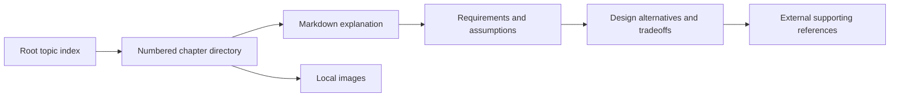
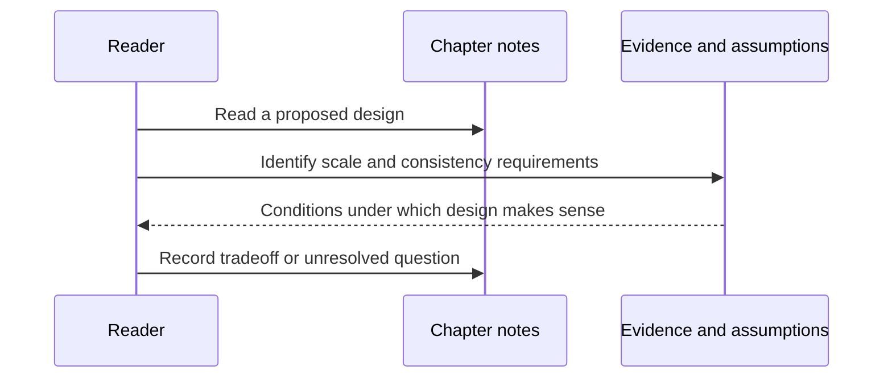

# Content architecture and conceptual flows

The source of truth here is text and image files. There is no runtime database, HTTP API, environment variable contract or application state schema. Case and spaces in directory names matter on Linux: early chapters generally use `Readme.md`, later ones often use `README.md`, and the digital-wallet directory contains two spaces after its numeric prefix. Copy actual paths rather than normalizing names casually and breaking links.

## Example: rate limiter chapter

`04. Rate Limiter/Readme.md` explains placement at the server or middleware, then compares token bucket, leaking bucket, fixed-window counter, sliding-window log and sliding-window counter. Its local images illustrate the models. The distributed discussion names counter synchronization, race conditions and Redis-based coordination. These are alternative design ideas, not an installed Redis service in this repository.

Read an algorithm by asking what state it retains, when it updates that state, what happens at a boundary, and what a rejected request observes. For example, the fixed-window discussion explicitly warns about bursts at adjacent window edges. The next useful maintenance improvement would be a precise worked timeline and assumptions, not a claim that one algorithm is universally best.

## Example: unique IDs and chat

The unique-ID chapter compares multi-master counters, UUIDs, a ticket server and a Snowflake-style layout. Its example layout uses one sign bit, 41 timestamp bits, five datacenter bits, five machine bits and 12 sequence bits. Those are the chapter's chosen example, not a universal ID standard. Clock rollback and worker identity deserve explicit reasoning before copying such a design into code.

The chat chapter sets a hypothetical scale and covers persistent WebSockets, stateless API work, stateful chat servers, message storage, discovery, notification and presence. It describes per-channel ordering and synchronization using a device's last seen message ID. These concepts explain how the diagram is meant to work; they do not prove delivery guarantees or a working multi-device implementation.

## Diagrams and rendering

Many chapters embed HTML `img` elements with width, height or margin styling. GitHub, a Markdown editor and a document exporter may render these differently. The text should explain the diagram's important meaning so an image width or missing asset does not erase the argument. Preserve descriptive alternative text and inspect local paths when a figure disappears.
