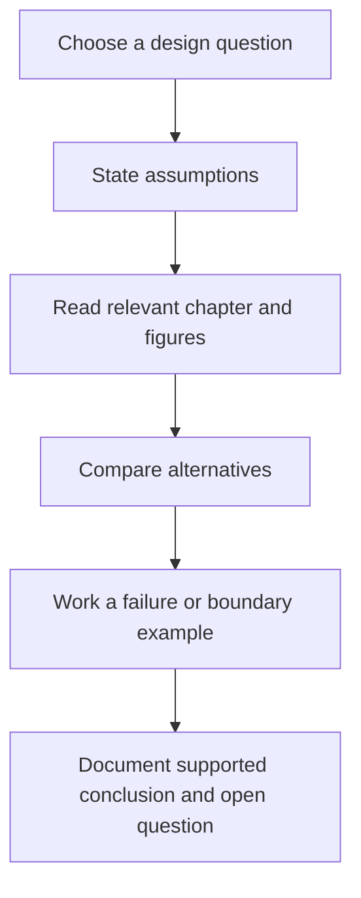

# A practical study session

## Start with a question

Choose a concrete question such as “How should a small service reject excessive requests?” Read the rate-limiter requirements before its algorithm catalog. Write down the assumed request volume, burst tolerance, identity key, storage availability and rejection behavior. Then compare the chapter's alternatives against those conditions. Do not choose Redis or a gateway solely because a diagram contains it.

For a chat-design session, identify whether ordering is per conversation or global, what happens when a device reconnects, and whether an acknowledged message is durably stored. The chapter discusses a synchronization cursor and offline notification. Use those as prompts to ask about missing guarantees instead of assuming the text specifies every retry and duplicate case.

For unique IDs, calculate how many IDs each worker must issue within one time unit, how worker identities are assigned, and what happens when time moves backward. The chapter's bit allocation is a useful example to reason about capacity. A successful reading session can end with an explicit unresolved question; it need not invent a definitive answer unsupported by evidence.

## Annotate responsibly

Separate existing notes from your proposed clarification. Add a small worked example or a clearly labeled assumption rather than rewriting an entire chapter around one application's constraints. Preserve source attribution and mark historical product-scale examples as historical examples. If an external link is stale, retain enough title/author context to locate the original source before replacing it with a superficially similar article.

## Close and retain useful work

There is no running service to stop. Save deliberate edits, inspect the diff and verify related links and figures. A learning session with no repository change need not produce a commit or operational memory file. If a chapter correction is useful, submit it as a scoped documentation change with the reasoning and source evidence needed by another reader.

